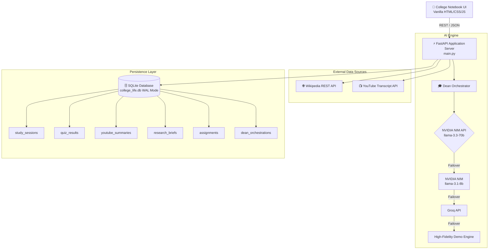

# 🎓 Hack Your College Life

<div align="center">


**An Autonomous Multi-Agent Academic Suite for First-Year College Students**  
*Accelerate exam prep, synthesize complex lectures, formulate research briefs, solve assignments, and monitor your freshman GPA in real time.*

[Key Features](#-key-features) • [Agent Roster](#-the-5-ai-agents) • [Architecture](#-architecture--data-flow) • [Quick Start](#-quick-start) • [API Reference](#-api-endpoints)

</div>

---

## 📖 Overview

Entering college is overwhelming: dense syllabi, fast-paced lectures, rigorous assignments, and relentless deadlines. **Hack Your College Life** is a full-stack, AI-powered collegiate co-pilot designed specifically to help freshmen conquer their academic workload.

Powered by **NVIDIA NIM** (leveraging `meta/llama-3.3-70b-instruct` with auto-fallback to `meta/llama-3.1-8b-instruct`), the platform unites **5 specialized AI agents** orchestrated under a unified command center, paired with a **zero-config persistent SQLite database** and an immersive **college-ruled notebook interface**.

---

## ✨ Key Features

- 🧠 **5 Specialized AI Agents:** Study Buddy, YouTube Summarizer, Wikipedia Research Assistant, Assignment Writer, and "Dean Vance" Multi-Agent Orchestrator.
- 🗄️ **Persistent Academic Vault:** Zero-config SQLite database (`college_life.db`) running with high-performance Write-Ahead Logging (WAL) mode.
- 📊 **Real-Time GPA & Analytics:** Dynamic Freshman GPA computation that recalculates instantaneously whenever an interactive quiz is completed.
- 📓 **College-Notebook Interface:** Nostalgic lined paper aesthetics, red margin rules, varsity collegiate header, 3D flip-cards, interactive quiz scoring, and realistic Dean sticky notes—built in 100% pure Vanilla JS/CSS (zero Node.js or npm dependencies required).
- 💾 **Export Anywhere:** Download research briefs and assignment solutions as cleanly formatted Markdown (`.md`), or export your entire academic database as a portable JSON backup.
- 🛡️ **Zero-Friction Fallbacks & Demo Mode:** High-fidelity built-in mock responses allow full UI and workflow demonstrations even without API keys configured.

---

## 🤖 The 5 AI Agents

```
                        ┌─────────────────────────────────┐
                        │      🎓 Dean Vance (Dean)       │
                        │    Multi-Agent Orchestrator     │
                        └───────────────┬─────────────────┘
                                        │ (JSON Plan Execution)
        ┌───────────────────┬───────────┴───────────┬───────────────────┐
        ▼                   ▼                       ▼                   ▼
┌──────────────┐    ┌──────────────┐        ┌──────────────┐    ┌──────────────┐
│ 📚 Study     │    │ 🎥 YouTube   │        │ 🔬 Research  │    │ 📝 Assignment│
│    Buddy     │    │   Summarizer │        │    Assistant │    │    Writer    │
└──────────────┘    └──────────────┘        └──────────────┘    └──────────────┘
```

### 1. 🎓 Dean Vance — The Orchestrator (`/api/dean`)
- **Role:** Central executive coordinator.
- **Workflow:** Accepts any complex collegiate prompt (e.g., *"Prepare me for my CS101 midterm on Recursion, summarize this YouTube lecture, and write study notes"*), formulates an intelligent multi-step execution plan, invokes necessary agents sequentially, performs automatic single-retry error recovery, and delivers execution timelines along with a handwritten-style **Dean's Supervisor Note**.

### 2. 📚 Study Buddy (`/api/study-buddy`)
- **Role:** Exam preparation & active recall generator.
- **Output:** Comprehensive structured study notes, **8 interactive 3D flip flashcards** (question front, detailed answer back), and **5 multiple-choice questions (MCQs)** with explanations.
- **Auto-Grading & Persistence:** Live quiz results directly sync to the database and update your cumulative GPA.

### 3. 🎥 YouTube Summarizer (`/api/youtube-summarizer`)
- **Role:** Lecture digestion & transcript analysis.
- **Workflow:** Automatically extracts captions via `youtube-transcript-api` from any standard or shortened YouTube URL. Includes a manual transcript paste fallback.
- **Output:** Executive summary, key concepts, bulleted takeaways, and review timestamps.

### 4. 🔬 Research Assistant (`/api/research-assistant`)
- **Role:** Academic literature & background exploration.
- **Workflow:** Connects to Wikipedia REST API with canonical OpenSearch title resolution for ground-truth facts. Generates formal collegiate literature reviews with citations and methodology overviews.
- **Export:** Instant one-click `.md` download.

### 5. 📝 Assignment Writer (`/api/assignment-writer`)
- **Role:** Step-by-step problem solver & coursework guide.
- **Output:** Pedagogical, step-by-step academic solutions with formulas, code snippets, reasoning, and conceptual explanations.
- **Export:** Instant one-click `.md` download.

---

## 🏗️ Architecture & Data Flow



---

## 🗄️ Database Schema (`college_life.db`)

All student interactions persist locally across sessions:

| Table | Description | Key Fields |
| :--- | :--- | :--- |
| `study_sessions` | Stored study kits & notes | `topic`, `notes`, `flashcards_json`, `mcqs_json`, `source` |
| `quiz_results` | Interactive quiz submissions | `topic`, `score`, `total`, `percentage`, `answers_json` |
| `youtube_summaries` | Summarized video lectures | `url`, `title`, `summary`, `takeaways_json`, `source` |
| `research_briefs` | Academic research documents | `topic`, `brief`, `sources_json`, `source` |
| `assignments` | Coursework solutions | `topic`, `solution`, `source` |
| `dean_orchestrations` | Multi-agent execution plans | `task`, `plan_json`, `results_json`, `timeline_json` |

---

## 🚀 Quick Start

### 1. Prerequisites
- **Python 3.10+** installed on your system.
- *(Optional)* Free NVIDIA NIM API key from [build.nvidia.com](https://build.nvidia.com/).

### 2. Clone Repository
```bash
git clone https://github.com/vishesh-i-tech/Hack-College-Life-AI-.git
cd Hack-College-Life-AI-
```

### 3. Install Dependencies
```bash
python -m pip install -r requirements.txt
```

### 4. Configure Environment
Copy `.env.example` to create your local `.env`:
```bash
# Windows PowerShell:
Copy-Item .env.example .env

# macOS / Linux:
cp .env.example .env
```

Open `.env` and configure your credentials:
```env
# Primary: NVIDIA NIM API (https://build.nvidia.com/)
NVIDIA_API_KEY=your_nvidia_api_key_here

# Optional: Groq fallback
GROQ_API_KEY=

PORT=8000
HOST=127.0.0.1
```
> 💡 **Demo Mode:** If you do not configure an API key, the app will run seamlessly in high-fidelity mock demonstration mode.

### 5. Launch Application
```bash
python main.py
```
*Or using Uvicorn directly:*
```bash
uvicorn main:app --reload --host 127.0.0.1 --port 8000
```

### 6. Open in Browser
Navigate to:
👉 **[http://127.0.0.1:8000](http://127.0.0.1:8000)**

---

## 🧪 Automated Testing

Execute the built-in test suite to verify all endpoints, database CRUD operations, and agents:

```bash
python test.py
```

The test runner validates:
- `GET /health` service readiness
- `POST /api/study-buddy` kit generation
- `POST /api/assignment-writer` problem breakdown
- `POST /api/youtube-summarizer` transcript synthesis
- `POST /api/research-assistant` wiki integration
- `POST /api/dean` orchestration workflow
- `GET /api/db/stats` & `GET /api/db/history` database operations

---

## 📡 API Endpoints

### 🤖 AI Agent Endpoints
- `POST /api/study-buddy` — Generate study notes, 8 flashcards, and 5 MCQs.
  ```json
  { "topic": "Calculus 1: Derivatives and Limits" }
  ```
- `POST /api/youtube-summarizer` — Extract video transcript and summarize lecture.
  ```json
  { "url": "https://www.youtube.com/watch?v=example", "transcript": "" }
  ```
- `POST /api/research-assistant` — Query Wikipedia and construct academic brief.
  ```json
  { "topic": "Quantum Computing Superposition" }
  ```
- `POST /api/assignment-writer` — Generate collegiate step-by-step solution.
  ```json
  { "topic": "Physics 1", "questions": "Derive projectile motion equations." }
  ```
- `POST /api/dean` — Orchestrate full multi-agent workflow from freeform prompt.
  ```json
  { "task": "I have an exam on Neural Networks tomorrow. Prepare flashcards and summarize the topic." }
  ```

### 🗄️ Database Endpoints
- `GET /api/db/stats` — Fetch cumulative counts and dynamic freshman GPA.
- `GET /api/db/history` — Unified reverse-chronological timeline of all student sessions.
- `POST /api/db/quiz-result` — Save quiz score submission with instant GPA update.
- `DELETE /api/db/history` — Clear academic database history.

---

## 📂 Project Structure

```
├── .env.example          # Environment variable template
├── .gitignore            # Git exclusion rules (safeguards secrets & DB)
├── README.md             # Comprehensive project documentation
├── requirements.txt      # Python package dependencies
├── main.py               # FastAPI application, agent pipelines, API routes
├── database.py           # SQLite connection, schemas, CRUD & GPA logic
├── test.py               # Automated verification and test suite
└── static/
    └── index.html        # College-notebook UI with Vanilla JS & CSS
```

---

## 📄 License

This project is licensed under the [MIT License](LICENSE). Built for college students everywhere.
